# Reel n Creel

### Overview

A fishing rehaul mod that adds various new fishes into the game, as well as introducing new fishing rods that uses a different fishing mechanic and makes it more engaging.

Currently it adds 6 new fishing rod, 53 new fish for different biomes and 2 new fish meat into the game.

### QOL change

When fishing with the mod's rods:

- Hold a Water Bucket in your other hand while you land a fish, and it goes into the bucket alive.
- Hold a Shulker Box or a Bundle instead, and the fish's meat goes straight inside.

### Fish

#### Rivers and lakes

_Fresh water in any land or river biome._

 **Creek Chub** (tiny). Cool and temperate rivers, lakes and highland waters. 
  **Longnose Dace** (tiny). Cold rivers, lakes and highland waters. 
 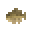 **Rock Bass** (tiny). Cool and temperate rivers, lakes and highland waters. 
  **Threadfin Shad** (tiny). Warm rivers and lakes. 
 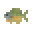 **Bluegill Sunfish** (small). Warm rivers and lakes; temperate highland waters; temperate and warm swamps. 
 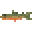 **Brook Trout** (small). Cold rivers, lakes and highland waters. 
  **Bullhead Catfish** (small). Warm rivers and lakes; temperate and warm swamps. 
 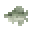 **Crappie** (small). Warm rivers and lakes. 
 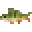 **European Perch** (small). Temperate rivers and lakes. 
 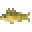 **Yellow Perch** (small). Cool rivers and lakes; cold and cool swamps. 
  **Arctic Char** (medium). Cold rivers, lakes and coasts. 
 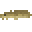 **Burbot** (medium). Cold rivers and lakes. 
 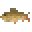 **Common Carp** (medium). Temperate and warm rivers and lakes; cool to warm swamps. 
 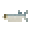 **Goldeye** (medium). Cool rivers and lakes. 
 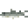 **Lake Trout** (medium). Cold rivers and lakes. 
 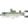 **Lake Whitefish** (medium). Cold rivers and lakes. 
  **Largemouth Bass** (medium). Warm rivers and lakes; temperate and warm swamps. 
  **Northern Pikeminnow** (medium). Cool rivers and lakes. 
 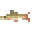 **Shorthead Redhorse** (medium). Temperate rivers and lakes. 
 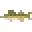 **Walleye** (medium). Cool rivers and lakes. 
  **White Bass** (medium). Warm rivers and lakes. 
 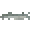 **Channel Catfish** (large). Warm rivers and lakes. Needs water at least 4 blocks deep. 
 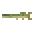 **Northern Pike** (large). Cool rivers and lakes; cold and cool swamps. Needs water at least 4 blocks deep. 
 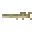 **Muskie** (very large). Cool rivers and lakes. Needs water at least 6 blocks deep. 
 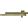 **Alligator Gar** (giant). Warm rivers and lakes; temperate and warm swamps. Needs water at least 6 blocks deep. 
  **White Sturgeon** (giant). Temperate rivers and lakes; cool and temperate coasts. Needs water at least 6 blocks deep.

#### Highland waters

_These fish are found in fresh water 40 or more blocks above sea level, or in a mountain biome._

 **Mountain Whitefish** (small). Cold highland waters. 
  **Arctic Grayling** (medium). Cold highland waters. 
 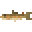 **Brown Trout** (medium). Cool and temperate highland waters. 
  **Cutthroat Trout** (medium). Cold highland waters. 
  **Rainbow Trout** (medium). Cold and cool highland waters. 
  **Smallmouth Bass** (medium). Cool and temperate highland waters. 
  **Tiger Trout** (medium). Cold highland waters. 
 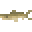 **White Sucker** (medium). Cool and temperate highland waters.

#### The salmon family

_Salmon are found in both rivers and at sea at varying biomes based on the species_

 **Masu Salmon** (medium). Cold to temperate rivers, lakes and highland waters; cold and cool coasts. Needs water at least 2 blocks deep. 
 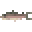 **Pink Salmon** (medium). Cold to temperate rivers, lakes and highland waters; cold and cool coasts; cold open sea. Needs water at least 2 blocks deep. 
 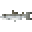 **Atlantic Salmon** (large). Cold to temperate rivers, lakes and highland waters; cold and cool open sea. Needs water at least 2 blocks deep. 
 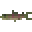 **Chum Salmon** (large). Cold to temperate rivers, lakes and highland waters; cold coasts and open sea. Needs water at least 2 blocks deep. 
  **Coho Salmon** (large). Cold to temperate rivers, lakes and highland waters; cold and cool coasts; cool open sea. Needs water at least 2 blocks deep. 
 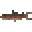 **King Salmon** (large). Cold to temperate rivers, lakes and highland waters; cold and cool open sea. Needs water at least 2 blocks deep. 
  **Steelhead** (large). Cold to temperate rivers, lakes and highland waters; cold coasts. Needs water at least 2 blocks deep.

#### Coasts and the sea

_These fish are found near beaches, stony shores, and ocean biomes._

 **Capelin** (tiny). Cold and cool coasts, open sea and deep sea. 
  **Pacific Herring** (small). Cold to temperate coasts and open sea. 
  **American Shad** (medium). Temperate rivers and lakes; temperate and warm coasts, open sea and deep sea. 
 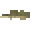 **Lingcod** (large). Cool and temperate coasts and deep sea. Needs water at least 4 blocks deep. 
 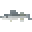 **Striped Bass** (large). Temperate rivers and lakes; temperate and warm coasts and open sea. Needs water at least 4 blocks deep. 
  **Yelloweye Rockfish** (large). Cool and temperate coasts; cold to temperate deep sea. Needs water at least 4 blocks deep. 
  **Barracuda** (very large). Warm coasts and open sea. Needs water at least 6 blocks deep. 
 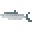 **Tarpon** (giant). Warm swamps; temperate and warm coasts; warm open sea. Needs water at least 6 blocks deep.

#### Giants of the open sea

_Spawns in ocean biomes, they need some space to spawn, at least 6 blocks deep of water._

 **Mahi-mahi** (very large). Temperate and warm open sea; warm deep sea.

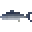 **Bluefin Tuna** (giant). Cold to temperate open sea; cold and cool deep sea.

 **Sailfish** (giant). Warm open sea and deep sea.

 **Yellowfin Tuna** (giant). Temperate and warm open sea and deep sea.

_Note: Vanilla Cods and Salmons still spawn, they aren't replaced :D_

### Fishing Rods

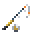  **Pebble Spinner** 
Hooks tiny and small fish. 
**Crafting:** a Fishing Rod and a Copper Ingot. 
Cast: 80% of a vanilla rod's throw. Durability: 64. Treasure chance: 1.5%.

  **Kingfisher Drift** 
Hooks small and medium fish. 
**Crafting:** a Fishing Rod, an Iron Ingot and a Lapis Lazuli. 
Cast: the same as a vanilla rod. Durability: 96. Treasure chance: 2.5%.

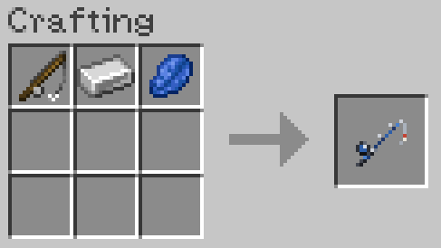

  **Amberleaf Caster** 
Hooks medium and large fish. 
**Crafting:** a Fishing Rod, a Copper Ingot and a Gold Ingot. 
Cast: 115% of a vanilla rod's throw. Durability: 128. Treasure chance: 3.5%.

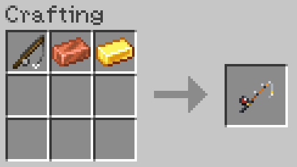

  **Mistral Pier** 
Hooks large and very large fish. 
**Crafting:** a Fishing Rod, 2 Iron Ingots and 2 String. 
Cast: 140% of a vanilla rod's throw. Durability: 160. Treasure chance: 5%.

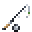  **Tidebreaker** 
Hooks very large and giant fish. 
**Crafting:** a Fishing Rod, a Diamond and a Leather. 
Cast: the same as a vanilla rod. Durability: 192. Treasure chance: 5%.

  **Ol' Mariner** 
Hooks every size of fish, from tiny to giant fish. 
**Crafting:** a Fishing Rod, an Angler Pottery Sherd (you can get them as a treasure using other rods, except vanilla) and a Nautilus Shell. 
Cast: the same as a vanilla rod. Durability: 224. Treasure chance: 3.5%.

_Note:_

- The recipes have no pattern: put the items anywhere in the crafting grid. They appear in the recipe book together with the vanilla Fishing Rod's.
- The rods take the fishing enchantments. Luck of the Sea makes the larger size class more likely to bite and raises the treasure chance. Lure shortens the wait, as on a vanilla rod. Unbreaking and Mending work as well.
- Durability: landing a fish costs 1, and a snapped line costs 3.
- The vanilla Fishing Rod is given a 3D design but still works the same as vanilla.

### Fish meat

Fish drop meat by their size class. The smaller kinds give Fish Morsels and the bigger kinds give Raw Fish.

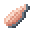  **Fish Morsel** 
Restores 1 hunger. 
Dropped by tiny fish (2) and small fish (2 to 4). 
Also crafted from Raw Fish: one Raw Fish makes 2 Fish Morsel. 
A fisherman villager pays 1 emerald for 4.

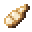  **Cooked Fish Morsel** 
Restores 2 hunger, and is eaten twice as fast as other food. 
Made by cooking a Fish Morsel in a furnace, a smoker or on a campfire.

  **Raw Fish** 
Restores 2 hunger. 
Dropped by medium fish (2), large fish (4), very large fish (6) and giant fish (8). 
Also crafted from a Raw Cod or a Raw Salmon, one for one. 
A fisherman villager pays 1 emerald for 1.

  **Fish Steak** 
Restores 5 hunger. 
Made by cooking Raw Fish in a furnace, a smoker or on a campfire.

### Breeding

To breed fish, feed seagrass to 2 of the same kind of fish, and they'll create fish spawn at the water surface, similar to how frog spawn works, each of them will spawn between 1-3 fishes. The size of the fish will generally be on the smaller side.

_Note:_

- the six giants don't breed;
- a pair has to wait 5 minutes before breeding again;
- you can lure fishes using Seagrass.
