# Reel n Creel

### Overview

A fishing rehaul mod that adds various new fishes into the game, as well as introducing new fishing rods that uses a different fishing mechanic and makes it more engaging.

Currently it adds 6 new fishing rod, 53 new fish for different biomes and 2 new fish meat into the game.

### QOL change

When fishing with the Reel n Creel's rods:
- You can use a Water Bucket in your off-hand while fishing to have the fish go into the bucket alive.
- You can use a Shulker Box or Bundle in your off-hand while fishing to have the fish be converted to morsel/meat, useful while fishing in a boat.

### Fish

#### Rivers and lakes

_These fish can be found in fresh water in any land/river biome_

| Size | Fish |
|---|---|
| **Tiny** | 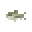 Creek Chub  Longnose Dace  Rock Bass 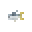 Threadfin Shad |
| **Small** |  Bluegill Sunfish  Brook Trout 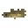 Bullhead Catfish  Crappie  European Perch  Yellow Perch |
| **Medium** |  Arctic Char  Burbot  Common Carp  Goldeye  Lake Trout  Lake Whitefish 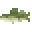 Largemouth Bass 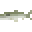 Northern Pikeminnow  Shorthead Redhorse  Walleye 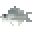 White Bass |
| **Large** |  Channel Catfish  Northern Pike |
| **Very large** |  Muskie |
| **Giant** |  Alligator Gar  White Sturgeon |

#### Highland waters

_These fish can be found in fresh water that are 40 or more blocks above sea level, like in a mountain biome. (These fish may be rare and may require modded terrain to spawn.)_

| Size | Fish |
|---|---|
| **Small** | 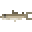 Mountain Whitefish |
| **Medium** | 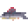 Arctic Grayling  Brown Trout 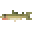 Cutthroat Trout 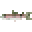 Rainbow Trout 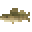 Smallmouth Bass 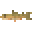 Tiger Trout  White Sucker |

#### The salmon family

_Salmon can be found in both rivers and at sea at varying biomes depending on the species._

| Size | Fish |
|---|---|
| **Medium** | 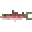 Masu Salmon  Pink Salmon |
| **Large** |  Atlantic Salmon  Chum Salmon 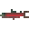 Coho Salmon  King Salmon 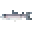 Steelhead |

#### Coasts and the sea

_These fish are found near beaches, stony shores, and ocean biomes._

| Size | Fish |
|---|---|
| **Tiny** | 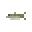 Capelin |
| **Small** | 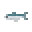 Pacific Herring |
| **Medium** | 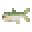 American Shad |
| **Large** |  Lingcod  Striped Bass 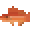 Yelloweye Rockfish |
| **Very large** | 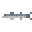 Barracuda |
| **Giant** |  Tarpon |

#### Giants of the open sea

_Spawns in deep ocean biomes, they need some space to spawn, at least 6 blocks deep of water so they don't suffocate in blocks upon spawning._

| Size | Fish |
|---|---|
| **Very large** | 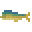 Mahi-mahi |
| **Giant** |  Bluefin Tuna  Sailfish 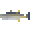 Yellowfin Tuna |

### Fishing Rods

  **Pebble Spinner** 
Every angler's journey starts somewhere, even if it is as small as a pebble. Hooks tiny and small fish. 
**Crafting:** a Fishing Rod and a Copper Ingot. 
Cast: 80% of a vanilla rod's throw. Durability: 64. Treasure chance: 1.5%.

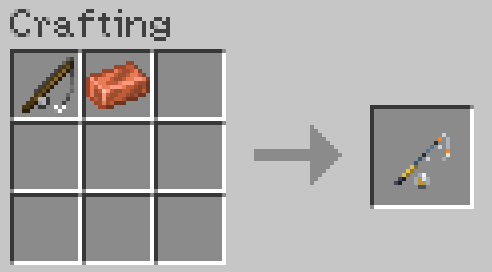

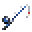  **Kingfisher Drift** 
It's color resembles the plume of a kingfisher, fish just as good as the bird itself. Hooks small and medium fish. 
**Crafting:** a Fishing Rod, an Iron Ingot and a Lapis Lazuli. 
Cast: the same as a vanilla rod. Durability: 96. Treasure chance: 2.5%.

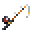  **Amberleaf Caster** 
An amber-colored rod for an amber-colored season. Hooks medium and large fish. 
**Crafting:** a Fishing Rod, a Copper Ingot and a Gold Ingot. 
Cast: 115% of a vanilla rod's throw. Durability: 128. Treasure chance: 3.5%.

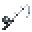  **Mistral Pier** 
Holding it makes you feel like a professional fisherman. Hooks large and very large fish. 
**Crafting:** a Fishing Rod, 2 Iron Ingots and 2 String. 
Cast: 140% of a vanilla rod's throw. Durability: 160. Treasure chance: 5%.

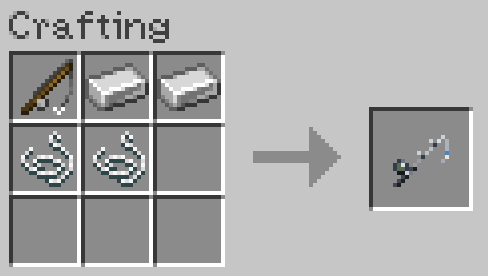

  **Tidebreaker** 
*Linea iacta est* — the line is cast. Hooks very large and giant fish. 
**Crafting:** a Fishing Rod, a Diamond and a Leather. 
Cast: the same as a vanilla rod. Durability: 192. Treasure chance: 5%.

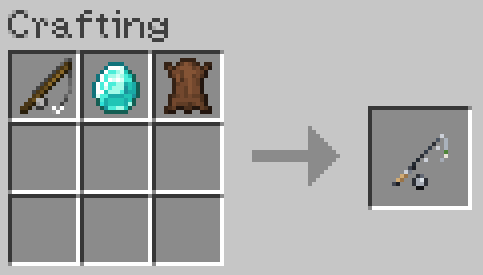

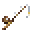  **Ol' Mariner** 
A trustworthy partner for a seasoned angler. Hooks every size of fish, from tiny to giant fish. 
**Crafting:** a Fishing Rod, an Angler Pottery Sherd (you can get them as a treasure using other rods, except vanilla) and a Nautilus Shell. 
Cast: the same as a vanilla rod. Durability: 224. Treasure chance: 3.5%.

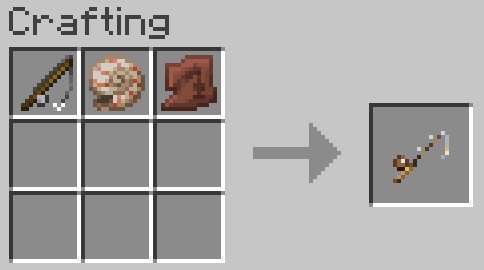

_Note:_

- For convenience, the recipes have no specific pattern, you can put the items anywhere in the crafting grid. They appear in the recipe book together upon unlocking the vanilla fishing rod.
- Fishing enchantments work on Reel n Creel's rod as well. Luck of the Sea makes the larger size class more likely to bite and raises the treasure chance. Lure shortens the wait and Unbreaking & Mending work as well.
- Durability: landing a fish costs 1, and costs 3 if you snap the line, so don't play your rods, wait—
- The vanilla Fishing Rod has been given a 3D design but still works the same as vanilla.

### Fish meat

Fish drop meat by their size class. The smaller kinds give Fish Morsels and the bigger kinds give Raw Fish.

  **Fish Morsel** 
Restores 1 hunger. 
Dropped by tiny fish (2) and small fish (2 to 4). 
Also crafted from Raw Fish: one Raw Fish makes 2 Fish Morsel. 
A fisherman villager pays 1 emerald for 4.

  **Cooked Fish Morsel** 
Restores 2 hunger, and is eaten twice as fast as other food. 
Made by cooking a Fish Morsel in a furnace, a smoker or on a campfire.

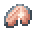  **Raw Fish** 
Restores 2 hunger. 
Dropped by medium fish (2), large fish (4), very large fish (6) and giant fish (8). 
Also crafted from a Raw Cod or a Raw Salmon, one for one. 
A fisherman villager pays 1 emerald for 1.

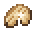  **Fish Steak** 
Restores 5 hunger. 
Made by cooking Raw Fish in a furnace, a smoker or on a campfire.

### Breeding

To breed fish, feed seagrass to 2 of the same kind of fish, and they'll create fish spawn at the water surface, similar to how frog spawn works, each of them will spawn between 1-3 fishes. The size of the fish will generally be on the smaller side.

_Note:_

- the six giants don't breed, to keep things balanced;
- fish have a 5 minute cooldown before you can breed them again;
- you can lure fishes using Seagrass.
